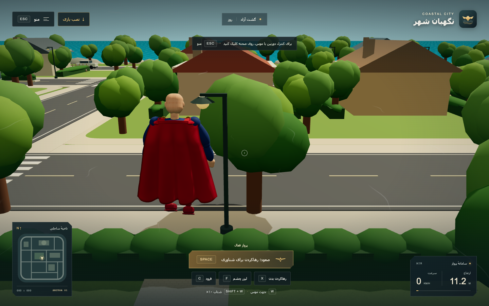

# 🦸 One Baldman

**One bald hero. A coastal city. Room to cause chaos.**

Take to the skies in a 3D superhero sandbox. Explore the streets, soar above the rooftops, and carve through the city with twin eye lasers.

- ⚡ **Fly fast** — hover, dive, and boost through the skyline.
- 🔥 **Break things** — cut through buildings and watch the debris fall.
- 🪂 **Let go** — tumble with ragdoll physics and a flowing red cape.
- 🌙 **Roam freely** — explore by day or night, on desktop or with touch controls.

---

**Take control**

- `WASD` Move · `Space` Ascend · `C` Descend · `Shift` Boost
- `F` Eye lasers · `X` Ragdoll / Recover · `Mouse` Look · `Esc` Menu

**Under the hood**

Built with TypeScript and React, with Three.js powering the 3D world. 
Rapier handles physics, ragdolls, debris, and the hero’s cape. 
Destructible geometry is processed in a Web Worker to keep gameplay responsive. 
Vite bundles the game as an installable PWA with offline support.
